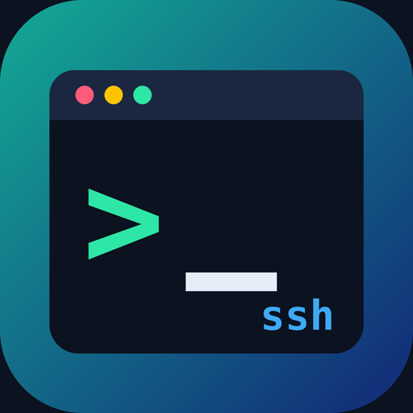
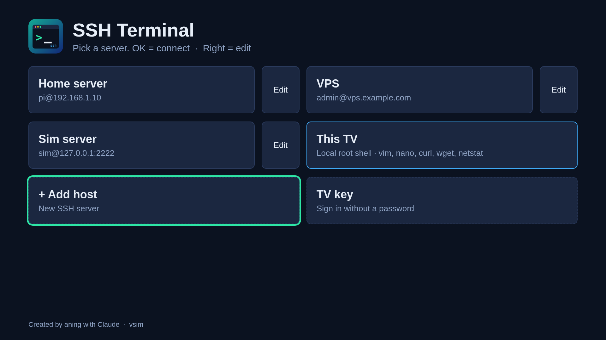
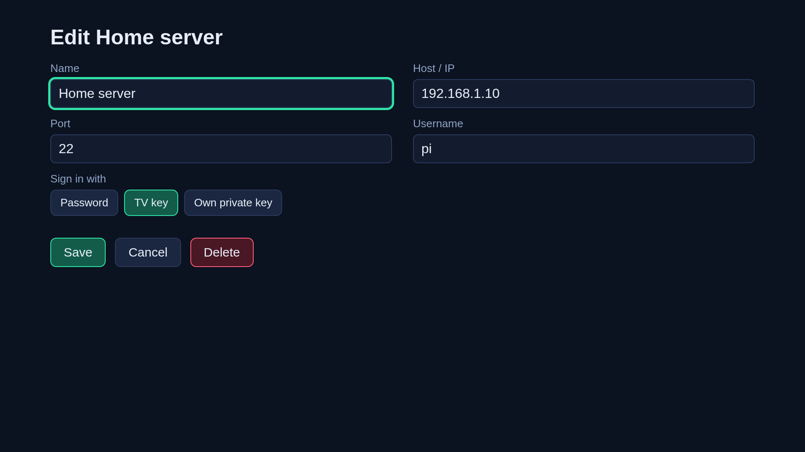
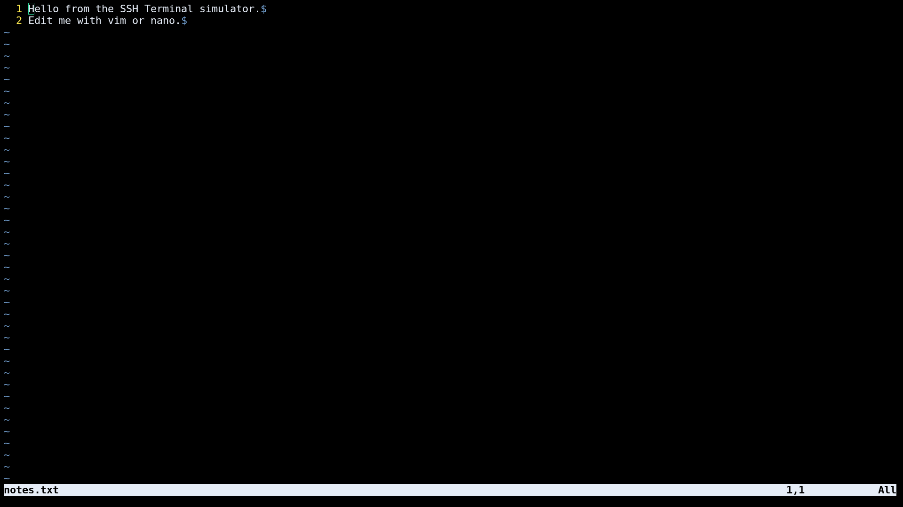
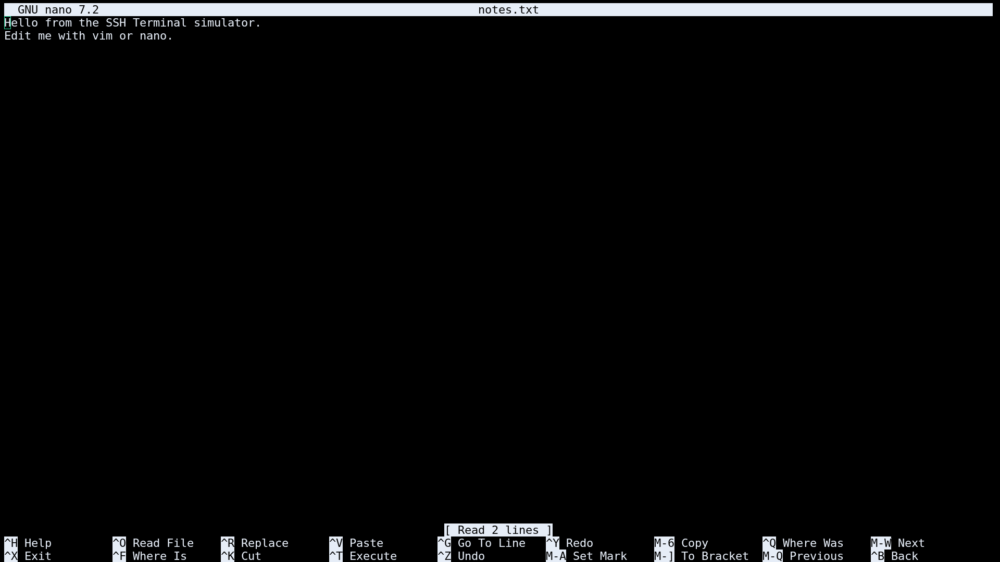
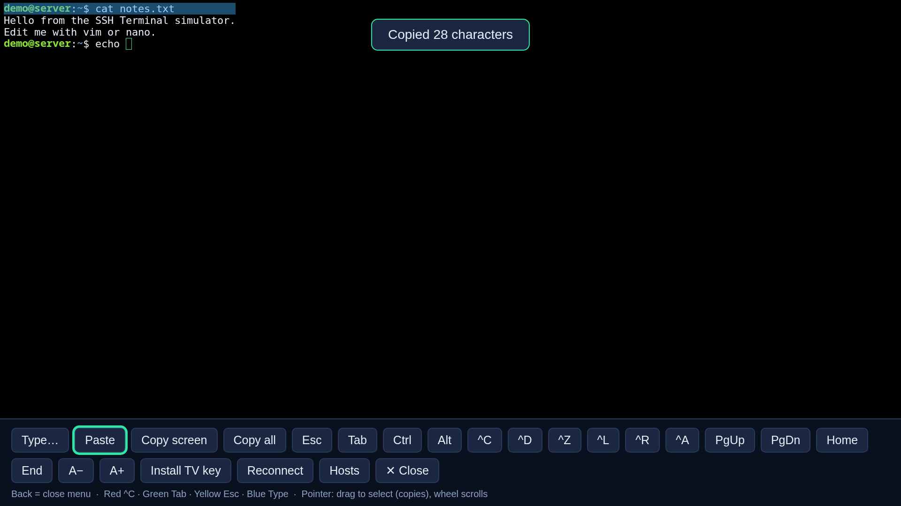
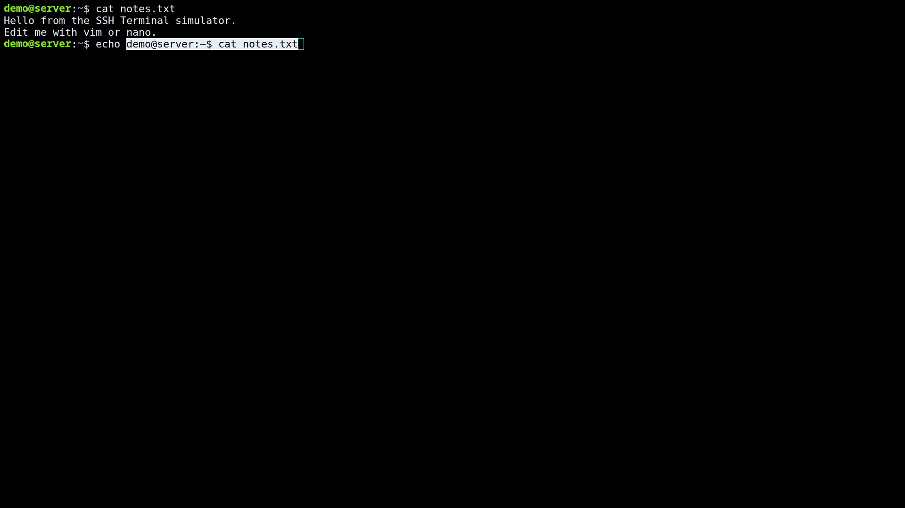
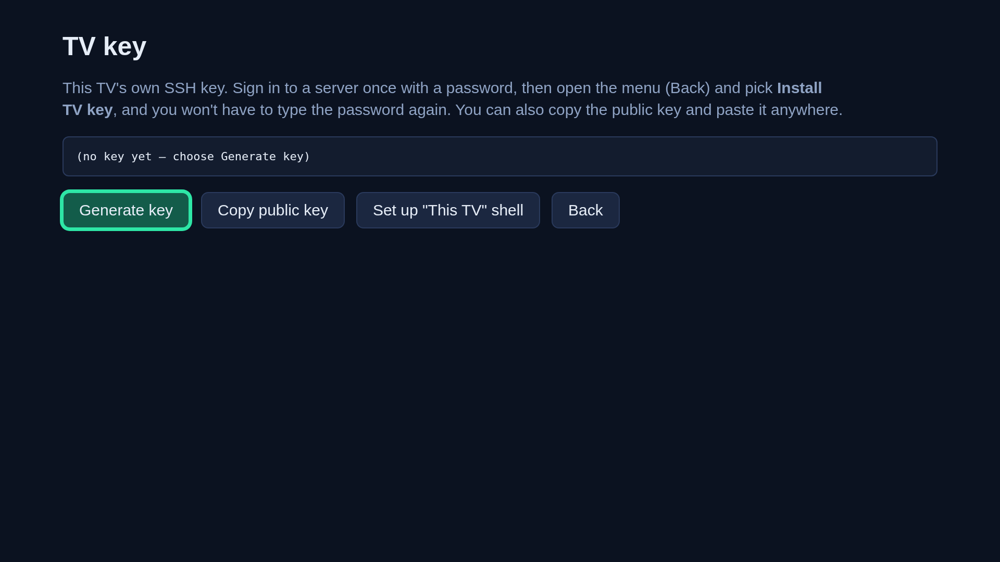
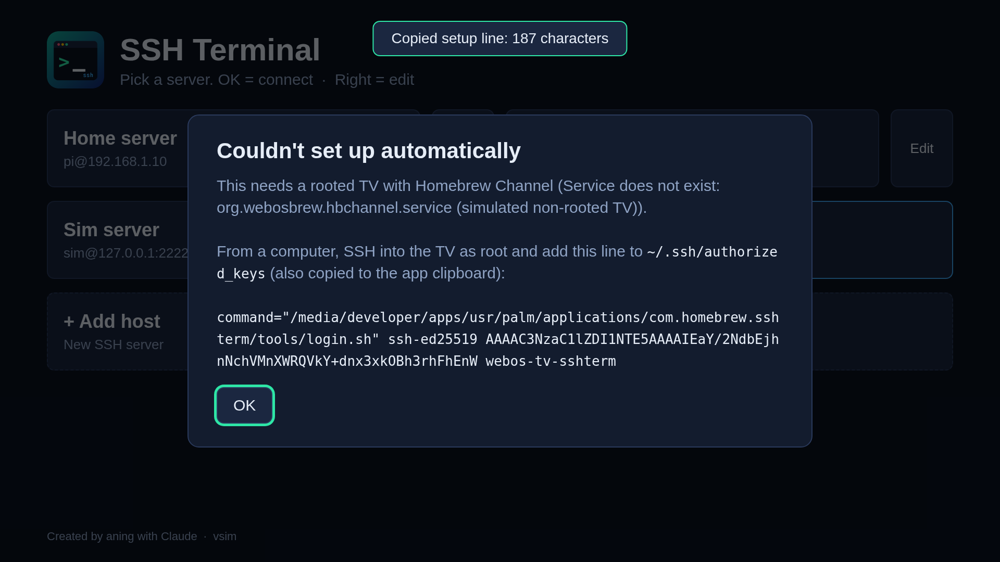

<p align="center"></p>

# SSH Terminal for webOS

An SSH client for LG webOS TVs. It gives you a full-screen terminal you can use with the Magic Remote or a USB/Bluetooth keyboard.

**Created by aning with Claude.**

> **Status (v1.0.0):** fully tested in the desktop simulator (`tools/sim`). Testing on a real LG TV is pending, and screenshots from the TV will be added here once that's done.

## Does it need a rooted TV?

**No.** Connecting to other servers works on any LG TV that can install homebrew apps.

| Feature | Not rooted (Developer Mode / Homebrew Channel) | Rooted |
|---|:---:|:---:|
| SSH to servers (password, TV key, or your own private key) | ✅ | ✅ |
| Full-screen terminal, vim/nano/htop **on the server** | ✅ | ✅ |
| Copy / paste, TV key, Install TV key on server | ✅ | ✅ |
| **"This TV"** local root shell with bundled **vim, nano, curl, wget, netstat** | ❌ | ✅ |

The SSH client runs inside the app's own background service (Node.js with [ssh2](https://github.com/mscdex/ssh2), in pure JavaScript), so it needs no root and no native code.
"This TV" works by logging in to the TV's own SSH server as root, which only exists on rooted TVs. Setup is one button press if Homebrew Channel has root.

## Install

**Homebrew Channel** (recommended): Settings → Add repository →

```
https://raw.githubusercontent.com/aningako/sshterm-webos/main/repo/apps.json
```

Then install **SSH Terminal** from the list.

**Manually:** download the `.ipk` from [Releases](https://github.com/aningako/sshterm-webos/releases), then run
`ares-install com.homebrew.sshterm_<version>_all.ipk`, or install it with the webOS Dev Manager.

## Using it

| Remote | In the terminal |
|---|---|
| Arrows / OK | Arrow keys / Enter |
| **Back** | Open the menu (Type…, Paste, Copy screen, Copy all, Esc, Tab, Ctrl, Alt, ^C ^D ^Z ^L ^R ^A, PgUp/PgDn, Home/End, font size, Install TV key, Reconnect, Hosts) |
| Red / Green / Yellow / Blue | Ctrl+C / Tab / Esc / **Type…** (opens the on-screen keyboard to send text) |
| CH+ / CH− | Page Up / Page Down |
| Pointer drag | Select text, which **copies it** automatically |
| Pointer wheel | Scroll back through output |

**Keyboard:** everything works as on a PC. Extra shortcuts: Ctrl+Shift+C copies, Ctrl+Shift+V or Shift+Insert pastes, Shift+PgUp/PgDn scrolls back.

**Copy / paste:** select text with the pointer (it's copied when you let go), or use *Copy screen* / *Copy all* in the menu, then *Paste* (or *Type… → Paste clipboard here*).
The clipboard is kept between sessions, so you can copy on one server and paste on another.

**TV key (sign in without a password):** on the home screen, open *TV key* → *Generate key*. Sign in to a server once with its password, then press Back → *Install TV key*.
The app adds the key to `~/.ssh/authorized_keys` on that server and offers to switch the host to key sign-in.

**This TV (rooted TVs):** choose *This TV*. The first time, the app uses Homebrew Channel to add the TV key to root's `authorized_keys`, with a forced command that puts the bundled tools on `PATH`.
After that you get a root shell where `vim`, `nano`, `curl`, `wget`, `netstat`, `xxd` and `busybox` just work.
Without root, the app shows the line to add by hand.

## Security notes

- Server host keys are checked (SHA256 fingerprint). You confirm a new server once, and you get a loud warning if its key ever changes.
- Saved passwords, the TV key and the clipboard are stored in the app's local storage on the TV. Leave the password empty to be asked each time.
- On the TV's own root account, the TV key is limited to running `tools/login.sh`.

## Screenshots (desktop simulator, 1920×1080)

| | |
|---|---|
|  |  |
|  |  |
|  |  |
|  |  |

## Build

```sh
# node_modules is committed; to refresh it (test/example folders are removed, they hold dummy keys):
(cd service/com.homebrew.sshterm.service && npm install --omit=optional --ignore-scripts && \
  find node_modules -type d \( -name test -o -name examples -o -name .github \) -prune -exec rm -rf {} +)
python3 scripts/fetch_tools.py      # vim/nano/curl/wget/busybox for armv7 from Alpine Linux (checksums verified)
python3 scripts/make_icons.py       # only if you change the icon
python3 scripts/build_ipk.py        # -> releases/com.homebrew.sshterm_<version>_all.ipk
python3 scripts/make_repo.py        # -> repo/apps.json + repo/manifest.json (Homebrew Channel)
```

### Simulator (no TV needed)

This runs the real app and the real luna service on a PC. A stand-in luna bus and a mock SSH server with a real pseudo-terminal replace the TV.

```sh
node tools/sim/server.js            # app on http://127.0.0.1:8080, mock SSH on 127.0.0.1:2222 (password printed)
node tools/sim/server.js --rooted   # pretend Homebrew Channel has root
python3 tools/sim/drive.py start    # optional: headless Chromium driven like a remote (key/type/shot/drag)
tools/sim/scenario_add_host.sh <password> <outdir>   # smoke test
```

You can also open http://127.0.0.1:8080 in a normal browser. Arrow keys and Enter act as the remote, and **F1 = Back**, F2–F5 = Red, Green, Yellow, Blue.

## Layout

```
app/com.homebrew.sshterm/        web app (index.html, app.js, style.css, xterm.js in lib/, DejaVu Sans Mono in fonts/)
service/com.homebrew.sshterm.service/   luna service: SSH via ssh2 (connect/write/resize/hostkey/auth/installKey/generateKey)
scripts/                         fetch_tools, build_ipk, make_repo, make_icons
tools/sim/                       desktop simulator
repo/                            Homebrew Channel repository files
```

## Credits & licenses

Created by aning with Claude. App code: MIT (see `LICENSE`).
Third-party components are listed in [THIRD_PARTY.md](THIRD_PARTY.md): xterm.js (MIT), ssh2 (MIT), DejaVu fonts (free license), and the Alpine Linux packages bundled for "This TV" (vim, nano, curl, wget, busybox and their libraries, under their own licenses, GPL included).
